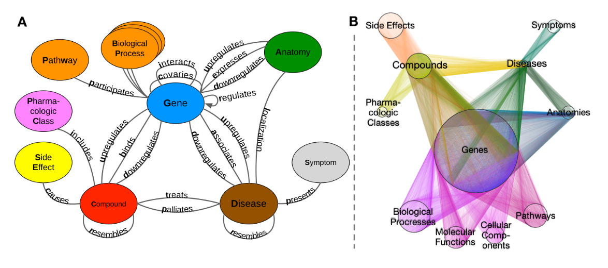

# Questions for the meeting

Meeting date: 2026-11-18. Source: the project proposal (Nov 13, 2026).

Status markers: `[ ]` open · `[x]` answered · `[~]` partly answered.
Write the answer under each question during the meeting.

## Planning and organization

- [ ] What are the exact dates (benchmark freeze, end of experiments, thesis deadline)?
  - Answer:

## Knowledge graph and chains (Hetionet)

*Hetionet metagraph: node types and relation types (Himmelstein et al., 2017).*

- [] Do we sample chains at random from the graph, or do we fix a set of path types
  (e.g. Compound → treats → Disease → resembles → Disease) and sample chains that follow them?
  - Answer:

## The three versions (real, counterfactual, fictional)

- [ ] Counterfactual version: do we change exactly one fact (one relation) per chain, never more?
  - Answer:
- [ ] Counterfactual version: where does the new fact come from? Do we replace one entity with
  another real entity of the same type taken from Hetionet (e.g. another Disease), or do we choose
  it freely?
  - Answer:
- [ ] Fictional version: which entities do we rename? Only the drugs (Compounds), all bridge
  entities whatever their type, or every entity in the chain (including the start and the answer)?
  - Answer:
- [ ] Fictional version: once an entity is renamed, do we replace its real name in the whole
  corpus ?
  - Answer:
- [ ] Follow-up: does the name style (drug-like vs neutral) only apply to the fictional version?
  The real and counterfactual versions keep the real names, so there is nothing to choose there.
  - Answer:

## Fact injection into documents

- [ ] When we rename a real drug in the fictional version, do we also replace its real name
  everywhere else in the corpus, before adding the distractors? Or do the other documents keep
  the real name?
  - Answer:
- [ ] Real version: how do we make sure the injected fact is not already stated somewhere else in
  the corpus? Is a lexical check (searching for both entity names in the same sentence or document)
  enough, or do we also need to catch synonyms and paraphrases?
  - Answer:

## Distractors, redundancy and name style

- [ ] Name style: for each renamed entity, the generator picks either a drug-like name
  (e.g. "Drexomil") or a neutral random name. Is that right? And do we create both styles for
  every chain, so we can compare them?
  - Answer:

## Filtering and hand-checking

- [ ]
  - Answer:

## Data and licenses (MedHopQA, MedRAG, Hetionet)

Context: licenses of the Hetionet edges (counted from `data/hetionet/`).

| License | Can we republish? | Main relations |
|---|---|---|
| CC0 | Yes, freely | Compound treats/palliates Disease, Compound resembles Compound, Disease resembles/localizes/presents, Disease up/downregulates Gene |
| CC BY 3.0 / 4.0 | Yes, with attribution | Gene participates (Biological Process, Pathway, ...), Pharmacologic Class includes Compound, part of Compound binds Gene |
| CC BY-SA 3.0, ODbL | Yes, with attribution and the same license | 1,711 Compound binds Gene, 5,940 Disease associates Gene |
| CC BY-NC, CC BY-NC-SA | Non-commercial only | most of Compound binds Gene (8,780), all of Compound causes Side Effect |
| No license | No (assume not) | Gene–Gene edges, Compound up/downregulates Gene, Anatomy up/downregulates Gene |

In short: CC0 alone has no Compound–Gene edges. Adding CC BY and CC BY-SA gives about 2,600
Compound binds Gene edges.

- [ ] Hetionet: the CC0 part has no Compound–Gene edges, yet the proposal's example
  ("Drexomil blocks kavotrin") is one. Can we also use the CC BY and CC BY-SA edges
  (about 2,600 Compound–binds–Gene edges, with attribution), or only CC0?
  - Answer:
- [ ] Do the licenses even matter if we only write the facts as sentences in documents and do not
  release the graph itself?
  - Answer:

## Baselines and metrics

- [ ]
  - Answer:

## Compute and LLM access

- [ ]
  - Answer:

## Deliverables (generator, benchmark v1, paper)

- [ ]
  - Answer:
